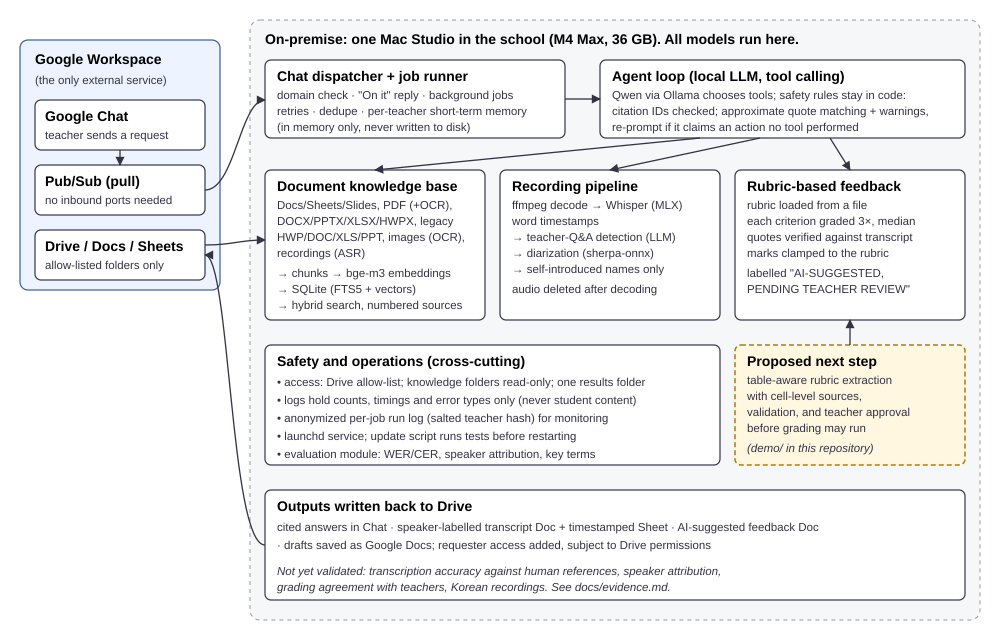

# localEd: portfolio

**localEd** is a self-hosted AI assistant I built for teachers at an IB school in Korea. A
teacher sends a request in Google Chat. A Mac Studio inside the school then finds and reads
school documents, transcribes oral-assessment recordings, drafts rubric-based feedback, and
writes the results back to Google Drive. Every model runs on that machine. The source code is
private because it runs on student data; this repository holds the public-safe case study,
the evidence, and a runnable demo of the next document-processing step.

| | |
|---|---|
| **Case study (2 pages)** | [case-study/case-study.md](case-study/case-study.md) · [PDF](case-study/case-study.pdf) |
| **Architecture** | [docs/architecture.svg](docs/architecture.svg) |
| **Evidence: what is measured and what is not** | [docs/evidence.md](docs/evidence.md) |
| **Runnable demo: rubric extraction with sources, validation and teacher approval** | [demo/](demo/README.md) |
| **Video script (2–3 min)** | [docs/demo-video-script.md](docs/demo-video-script.md) |
| **Backlog** | [docs/backlog.md](docs/backlog.md) |



## What it does today (private repository)

- **Document knowledge base:** reads the school's files (Google Docs/Sheets/Slides, PDF with OCR
  fallback, DOCX/PPTX/XLSX/HWPX, legacy HWP/DOC/XLS/PPT, images, recordings), indexes them
  locally and answers teachers' questions with numbered source references. Citation IDs are
  checked; source support still needs review.
- **Agent with tools:** a local LLM (Qwen via Ollama) chooses among tools: search, read,
  transcribe, grade, check jobs, save as Google Doc. Safety rules live in code, not in the prompt.
- **Oral assessments:** Whisper (MLX) transcription with word timestamps, teacher-Q&A detection,
  speaker diarization, and rubric-based, quote-verified feedback, always labelled
  *AI-suggested, pending teacher review*. The configured rubric is a placeholder for a
  different assessment; validated grading and the production teacher-approval gate are incomplete.
- **Operations:** runs as a background service; Pub/Sub pull (no inbound ports); allow-listed
  Drive folders; logs without student content; anonymized run log; an evaluation module (WER/CER,
  speaker attribution); 225 automated tests.

## Measured so far (details and limits in [docs/evidence.md](docs/evidence.md))

- **Pilot on 5 English oral assessments (24 min 15 s of audio, Apple M4 Max):** 5 of 5 pipeline
  runs completed in 180.61 s, Drive download to rendered transcript. Speech recognition took
  39.75 s (Whisper large-v3-turbo) against 78.23 s (full large-v3).
- **Failures found:** mixed speaker labels, one missed Q&A boundary, and a placeholder rubric for
  the wrong assessment, which led to the demo below.
- **Not yet measured:** accuracy against human-checked transcripts, grading agreement with teachers,
  Korean recordings, and teacher time saved. No accuracy figure is claimed until those exist.

## Run the demo (2 minutes, Python 3.10+ (`python3`), no installs)

```bash
cd demo
python3 -m rubric_pipeline demo
python3 -m unittest discover -s tests -v
```

It uses synthetic files only, written for this repository. No student, staff or school data
appears anywhere in this repository.

## My role

I teach Computer Science and English. I designed localEd, set its privacy and
safety rules, decided what to measure, and deployed it. The code was written with AI coding
agents (Claude Code, Codex) that I directed, reviewed and tested.

*Eun Johng Kim · [github.com/ej-kim-dev](https://github.com/ej-kim-dev)*
