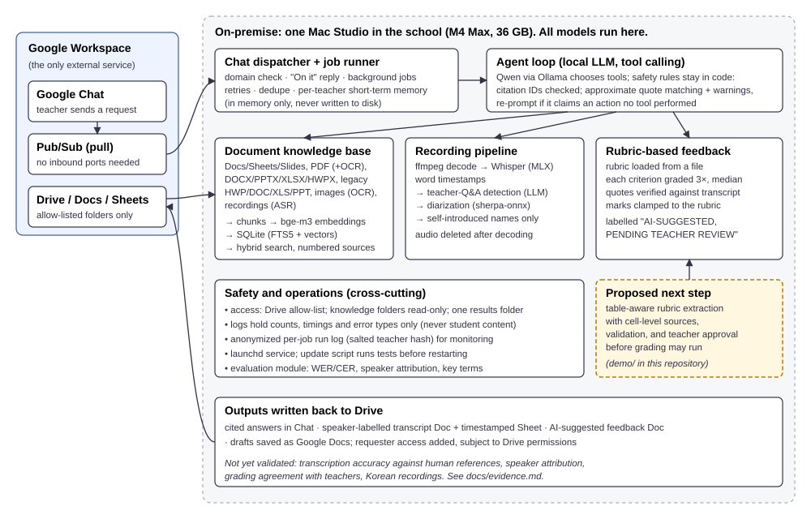

## The problem

Teachers at an IB international school in Korea run oral assessments (about 240 recordings a
year are planned: ~180 English, ~60 Korean) and live in a sea of school documents: rubrics,
guidelines, policies, forms, many of them Word, PDF or Hangul (HWP) files. Transcribing a
recording, finding the right rubric, and writing feedback against it are slow, repetitive jobs.
Cloud AI tools were not an option for student recordings and records, and teachers will not
adopt a new app. **Goal:** a teacher types a request in Google Chat, and the work happens on a
machine inside the school, with every output traceable and nothing graded without a teacher.

## What I did

I am a Computer Science and English teacher. I own this project end to end: I defined the
workflow, set the privacy rules, chose the architecture, and decided what
"done" means. I built it with AI coding agents (Claude Code and Codex) under my direction:
I specified each change, reviewed and tested it, and deployed it on the school's Mac Studio. I
also set up the evaluation: what to measure, on which data, and which claims are not yet allowed.

## Architecture and key decisions

{width=100%}

- **Everything runs on-premise.** Whisper (MLX) for speech, a Qwen model via Ollama for
  reasoning and tool calling, bge-m3 for embeddings, sherpa-onnx for speaker diarization, and
  the OS's own OCR. Google Workspace is the only external service. Google Chat reaches the
  machine via Pub/Sub *pull*, so the school network needs no inbound ports.
- **Document ingestion for real school files:** Google Docs/Sheets/Slides, PDF with OCR fallback
  for scanned pages, DOCX/PPTX/XLSX/HWPX parsed with the standard library, legacy HWP/DOC/XLS/PPT,
  images and recordings. Text is chunked and indexed (SQLite FTS5 + vectors) for hybrid search.
- **Code enforces the rules; the model doesn't.** Answers must cite numbered sources, and the code
  renumbers and validates them. Quoted text is checked word-for-word against the source. Marks
  are clamped to the rubric and graded three times (median kept). Every AI mark is labelled
  "AI-suggested, pending teacher review". The agent is re-prompted if it claims an action
  that no tool actually performed.
- **Access and privacy:** Drive folders are allow-listed (knowledge folders are read-only).
  Results are shared only with the requesting teacher. Logs record counts, timings and error
  types, never student content. Recordings are deleted after decoding.

## Measured results, with their exact scope

A benchmark on five English practice speaking assessments (24 min 15 s of audio, one Apple
M4 Max, 10 Nov 2026) found:

- **All 5 of 5 pipeline runs completed, in 180.61 s total** (about 8× faster than real time).
  That covers Drive download, decoding, speech recognition, Q&A detection, diarization, name
  checks and rendering. Google Doc creation and Chat transport were not included.
- **Speech recognition took 39.75 s with Whisper large-v3-turbo**, against 78.23 s for full
  large-v3.
- **The test suite passes (225 tests)** on Linux; macOS-only parts are excluded there.

**Not yet measured:** accuracy against a human-checked transcript, speaker attribution,
agreement with teachers' grades, Korean recordings, and teacher time saved. I don't report an
accuracy figure until a teacher-verified reference set exists (details: `docs/evidence.md`).

## What failed, and what I changed because of it

- **Speakers were mixed.** Teacher questions and student answers sometimes shared one speaker
  label. In one recording the two voices were never separated. Forcing "two speakers" made it
  worse, so a fix that keeps the count automatic and merges stray micro-speakers is drafted;
  it is not yet merged or re-benchmarked.
- **One recording got no Q&A boundary**, even though its own transcript contained the teacher's
  questions. It is the first regression test on the backlog.
- **The configured rubric was a placeholder for a different assessment** (/40 instead of /30).
  The benchmark refused to grade, and that exposed a bigger issue: grading should never start
  from an unchecked rubric.
- **Speech recognition can "correct" learner grammar** ("they wearing" → "they are wearing"),
  which would distort a Language criterion. Transcripts for assessment must be word-for-word,
  and that has to be measured, not assumed.

## The next document-processing improvement

The placeholder-rubric failure points at a document problem. localEd's Word reader was built
for search, and it flattens tables: a synthetic rubric becomes **58 loose paragraphs**, with
band marks separated from their descriptors. The demo in this repository fixes that step:

1. **Retrieve** the rubric from allow-listed folders, citing file and position. A file outside
   the allow-list, including via `../` or a symlink, is refused.
2. **Extract** it table-aware into criteria, band marks and descriptors. Every value carries its
   source cell (e.g. *table 1, row 2, column 4*).
3. **Validate** with explicit rules: bands must increase, every band needs a descriptor, no
   duplicates, and the total must match the document. A broken draft yields three located errors.
4. **Require teacher approval** of the exact file (SHA-256 fingerprint) before grading may run.
   Any later edit voids the approval.

It is deterministic, uses only the standard library, and has 15 tests. Its output loads
unchanged in localEd's grader format. **Next:** a small extraction benchmark (field-level exact
match and source-reference correctness on synthetic and public rubrics and forms), then the
same pattern for other school forms. In time, a layout-aware document parser could replace the
hand-written reader where scans and complex layouts need it.
